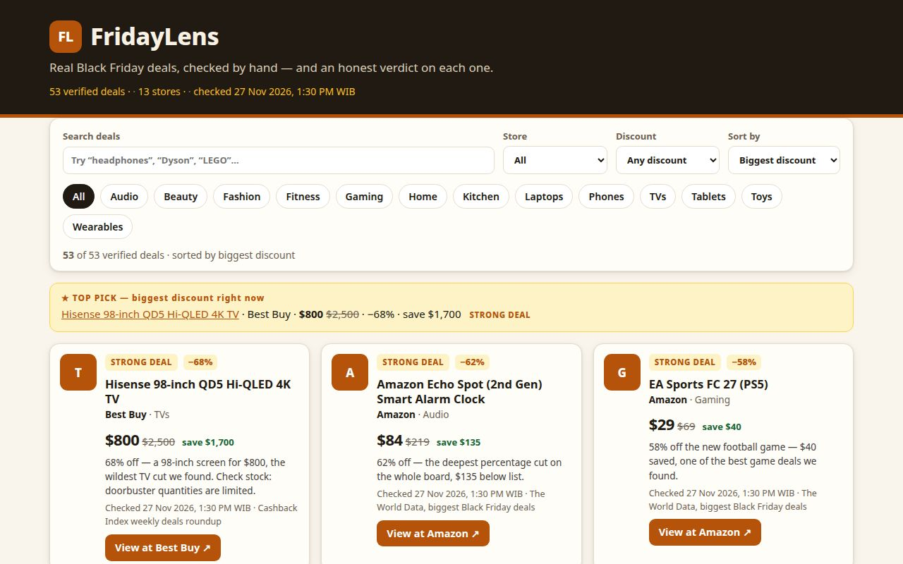
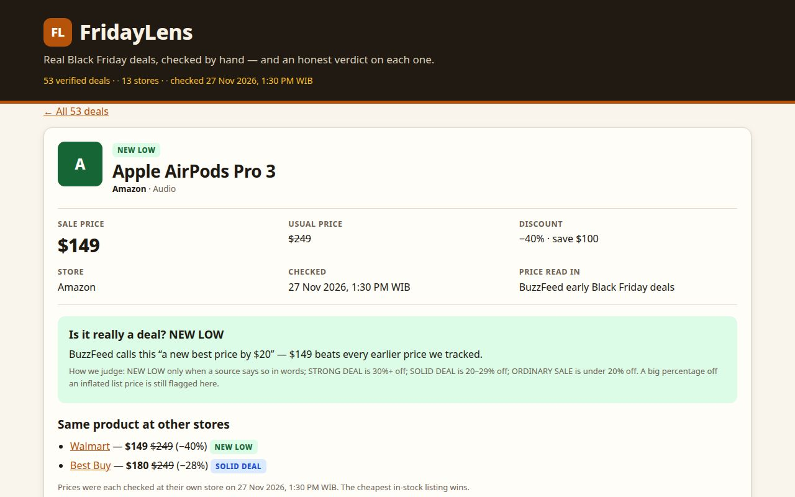
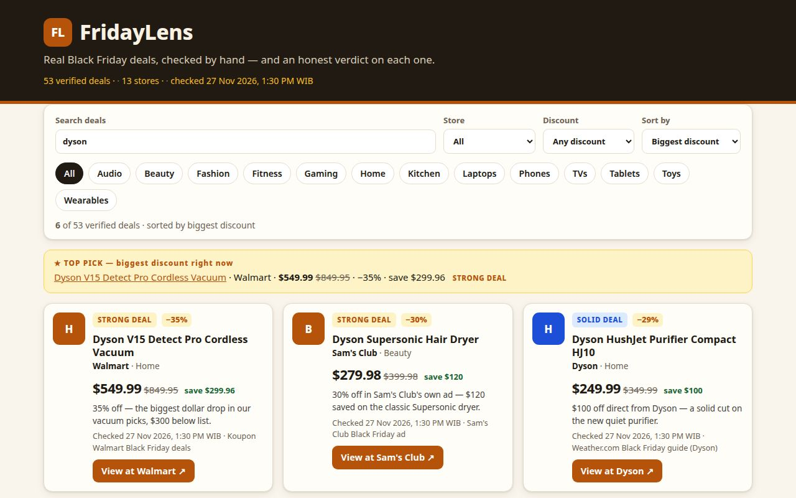
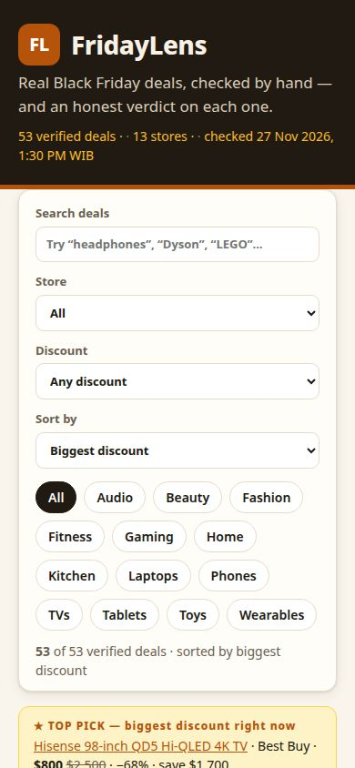

# FridayLens — Verified Black Friday Deal Finder

[](https://make.fun/bounty/black-friday-deal-finder-01?utm_source=github&utm_medium=readme&utm_campaign=black-friday-deal-finder-01)
[](https://make.fun/bounty/black-friday-deal-finder-01/leaderboard?utm_source=github&utm_medium=readme&utm_campaign=black-friday-deal-finder-01)
[](https://make.fun/bounty/black-friday-deal-finder-01?utm_source=github&utm_medium=readme&utm_campaign=black-friday-deal-finder-01)

FridayLens is a Black Friday and Cyber Monday deal finder for the make.fun
"Build the best real Black Friday deal finder" bounty
([bounty page](https://make.fun/bounty/black-friday-deal-finder-01)).
It lists **53 real deals across 13 categories and 13 stores**, and every one was
found and checked by the agent on **27 Nov 2026** — product, store, sale price,
usual price, a link to the product at the store, and when the price was checked.

What makes it different from a deals list is the verdict: each deal carries an
honest signal saying whether it is really a deal.

- **NEW LOW** — only when a source says so in words ("new best price",
  "first recorded deal", or below last year's Black Friday low). 4 deals.
- **STRONG DEAL** — 30%+ off the usual price. 27 deals.
- **SOLID DEAL** — 20–29% off. 16 deals.
- **ORDINARY SALE** — under 20% off, flagged plainly instead of hyped. 6 deals.

## Run it

Serve it locally, then open http://localhost:8080:

```sh
node serve.ts
```

Or just open `app/index.html` in desktop Chrome — the site is plain static files
with no network requests and no build step. It works on a phone too.

## Use it

- **Search** live: try "headphones", "Dyson", "LEGO".
- **Filter** by category (chips), store, and minimum discount (20%+ / 30%+ / 40%+ / 50%+).
- **Sort** by biggest discount, biggest saving in dollars, lowest price, or newest checked.
- **Open a deal** for the full story: price breakdown, the evidence behind its
  verdict, what to check before you buy, and — where the same product is listed
  at more than one store — a side-by-side comparison (AirPods Pro 3 at Amazon,
  Walmart and Best Buy; the Switch 2 bundle at Amazon and Walmart).
- The list is sorted by biggest discount first, so the best deals are on top.

## How the deals were checked

Each price was read on 27 Nov 2026 from a deals source that names the store and
shows both prices (deal trackers and roundups from Tom's Guide, TechRadar,
GamesRadar+, Product Bible, BuzzFeed, RetailShout, Koupon, Cashback Index,
The World Data, and the stores' own Black Friday ads). The discount is computed
from the two prices. Deals whose usual price could not be verified were dropped,
not guessed. Store links go to the store's own search for the exact product.
Prices move fast on Black Friday — the site says so, and tells shoppers to
confirm the price at the store before buying.

## What is in here

- `app/` — the site: `index.html`, `style.css`, `main.js` (routing), `views.js`
  (pages), `filters.js` (search, filter, sort), `data.js` (the 53 checked deals).
  Nothing it loads comes from the network.
- `main.ts` — the Node 22 entry program: copies `app/` and `screenshots/` to the
  output directory and writes `dossier.json` with the vendored make.fun library.
- `serve.ts` — a tiny static file server for local testing.
- `screenshots/` — four real renders of the site's own code: the deal list, a
  deal detail page, a filtered search, and the phone layout.
- `vendor/makefun-frontend.ts` — the make.fun frontend library, copied from the
  kit unchanged.

## Screenshots






## License

MIT — see [LICENSE](LICENSE).
